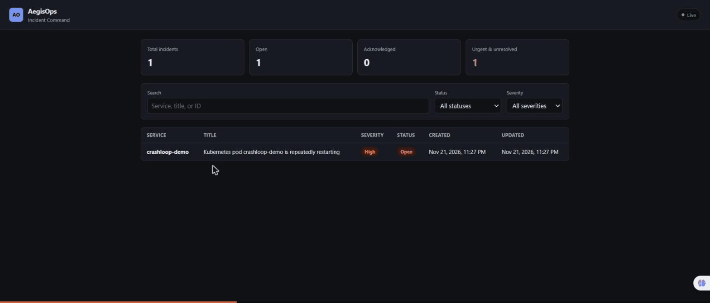
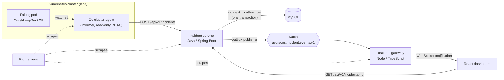

# AegisOps

[](https://github.com/Sharanjoo/aegisops/actions/workflows/ci.yml)


[](LICENSE)

**Event-driven incident pipeline for Kubernetes: a Go agent detects crash-looping pods and streams them to a live dashboard over Kafka and WebSockets.**

> **Status:** detection, incident tracking and live visibility work today.
> Automated remediation (the "self-healing" part) is **not built yet**. The agent is
> deliberately read-only. See [What I'd improve next](#what-id-improve-next).

## The problem

In a microservice cluster, a pod can crash-loop for a long time before anyone notices,
and the signal is buried in `kubectl` output and logs. Self-healing operations starts with
reliably detecting a failure, recording it once, and getting it in front of an operator
quickly. AegisOps builds that foundation first.

## Demo



The dashboard picks up a new incident live, without a page refresh, after a pod is made to
crash-loop (the Go agent detects it and the incident flows through the pipeline behind the
scenes). A step-by-step version is in [`docs/demo.md`](docs/demo.md).

## Architecture



**One failure, end to end**

1. A container's pod enters `CrashLoopBackOff`. The Go agent sees the Pod update through a
   Kubernetes informer and produces a finding.
2. A de-duplicator suppresses repeat findings for the same container within a cooldown, so
   one crash loop does not create a flood of incidents.
3. The agent POSTs the incident to the incident service, which stores it in MySQL and writes
   an event to an outbox table in the same transaction.
4. A scheduled publisher sends pending outbox events to Kafka, keyed by incident ID.
5. The realtime gateway validates each event (Zod) and broadcasts a small WebSocket
   notification.
6. The dashboard receives the notification, fetches the full incident over REST, and updates
   the table. It also re-syncs over REST after a reconnect.

More detail: [`docs/architecture.md`](docs/architecture.md).

## Key features

- Crash-loop detection from Pod status via Kubernetes informers (Go, client-go).
- De-duplication of repeated findings, with retry if incident creation fails.
- Transactional outbox: an incident and its event are committed together.
- At-least-once Kafka delivery, ordered per incident (incident ID is the message key).
- Schema validation of events in both the gateway and the dashboard.
- Live dashboard with WebSocket updates and REST reconciliation.
- Prometheus metrics for the agent, incident service and gateway, with alert rules.
- Least-privilege agent: RBAC is `get/list/watch` on Pods only; containers run non-root with
  dropped capabilities.
- Kustomize manifests for a local kind cluster, plus a scripted end-to-end test that runs in CI.

## Tech stack

| Choice                          | Why                                                                                                          |
| ------------------------------- | ------------------------------------------------------------------------------------------------------------ |
| Go + client-go informers        | The standard way to watch cluster state efficiently, and it ships as one small static binary.               |
| Java 21 / Spring Boot + MySQL   | A transactional store makes the incident-plus-outbox write atomic.                                           |
| Kafka                           | Decouples incident creation from consumers and keeps per-incident ordering via the message key.             |
| Node / TypeScript (Fastify, ws) | Lightweight I/O-bound bridge from Kafka to WebSocket clients, with Zod validating the event schema.        |
| React + Vite                    | Fast dev loop for a read-only live view; tested with Vitest.                                                 |
| Kustomize + kind                | Reproducible local cluster with no cloud account; Helm/Terraform are on the roadmap.                         |
| Prometheus                      | Standard pull-based metrics; each service exposes `/metrics`.                                                |
| GitHub Actions + Trivy          | Lint, tests, image builds and vulnerability scans on every push and PR.                                      |

<!-- TODO: confirm: the "Why" column is written from what the code does, not from recorded design notes. -->

## Quick start

Prerequisites: Docker, and for the Kubernetes path also [kind](https://kind.sigs.k8s.io/),
`kubectl` and [PowerShell 7](https://learn.microsoft.com/powershell/) (`pwsh`, used by the scripts).

### Option A: Docker Compose (no Kubernetes)

Runs MySQL, Kafka, the incident service, the gateway and the dashboard. The Go agent needs a
cluster, so here you create an incident by hand.

```bash
cp infrastructure/local/.env.example infrastructure/local/.env
docker compose -f infrastructure/local/compose.yaml up -d --build
```

Open <http://localhost:8090>, then in another terminal:

```bash
curl -X POST http://localhost:8080/api/v1/incidents \
  -H "Content-Type: application/json" \
  -d '{"serviceName":"checkout","title":"Pod is repeatedly restarting","severity":"HIGH"}'
```

The incident appears in the dashboard live. Stop with
`docker compose -f infrastructure/local/compose.yaml down`.

### Option B: kind (full flow with the Go agent)

```bash
kind create cluster --name aegisops-dev --config infrastructure/kind/cluster.yaml
cp infrastructure/kubernetes/overlays/kind-local/.env.example infrastructure/kubernetes/overlays/kind-local/.env
pwsh infrastructure/scripts/deploy-kind.ps1
pwsh infrastructure/scripts/verify-kind.ps1
kubectl port-forward -n aegisops-system svc/dashboard 8080:8080
```

Open <http://localhost:8080>. The `.env` file holds local-only placeholder database
credentials; edit them if you like. It is git-ignored.

### Trigger a failure and watch it get detected

With the port-forward above running:

```bash
kubectl run crashloop-demo --image=busybox:1.36.1 --restart=Always \
  --labels="app.kubernetes.io/name=crashloop-demo" --command -- sh -c "exit 1"
```

Within roughly a minute the pod reaches `CrashLoopBackOff`, the agent logs
`CrashLoopBackOff detected`, and an incident appears in the dashboard. Clean up with
`kubectl delete pod crashloop-demo`. The same flow is automated in
`pwsh infrastructure/scripts/e2e-kind.ps1`.

Note: the incident appears and is tracked, but the pod is **not** restarted or repaired by
AegisOps. That is the unbuilt remediation step.

### Run the tests

```bash
(cd services/cluster-agent && go test ./...)
(cd services/realtime-gateway && npm ci && npm test)
(cd apps/dashboard && npm ci && npm test)
(cd services/incident-service && ./mvnw clean test)   # needs Docker (Testcontainers)
```

## Project structure

```text
aegisops/
├── apps/dashboard/            # React dashboard
├── services/
│   ├── cluster-agent/         # Go: Kubernetes failure detection
│   ├── incident-service/      # Java / Spring Boot: REST API, MySQL, outbox, Kafka
│   └── realtime-gateway/      # Node / TypeScript: Kafka to WebSocket bridge
├── infrastructure/
│   ├── kind/                  # Local cluster config
│   ├── kubernetes/            # Kustomize base + kind-local overlay
│   ├── local/                 # Docker Compose
│   └── scripts/               # deploy / verify / e2e (PowerShell)
├── docs/                      # architecture, runbook, observability, demo, full reference
└── .github/workflows/         # CI
```

More detail, API and event contract, and the Kubernetes runbook:
[`docs/reference.md`](docs/reference.md), [`docs/architecture.md`](docs/architecture.md),
[`docs/runbook.md`](docs/runbook.md), [`docs/observability.md`](docs/observability.md).

## What I'd improve next

- **Remediation engine** (Go): operator-approved, policy-bounded actions. This is the missing
  piece for true self-healing.
- Detection beyond `CrashLoopBackOff` (for example metrics-driven detection via Prometheus).
- Acknowledge/resolve controls and authentication on the dashboard.
- Dead-letter and retry topics, and distributed tracing.
- Grafana dashboards and external alert delivery.
- Helm charts and a cloud deployment.

## Author

Sharan Joseph · [LinkedIn](https://www.linkedin.com/in/YOUR-HANDLE) <!-- TODO: add LinkedIn URL -->

## License

[MIT](LICENSE)
